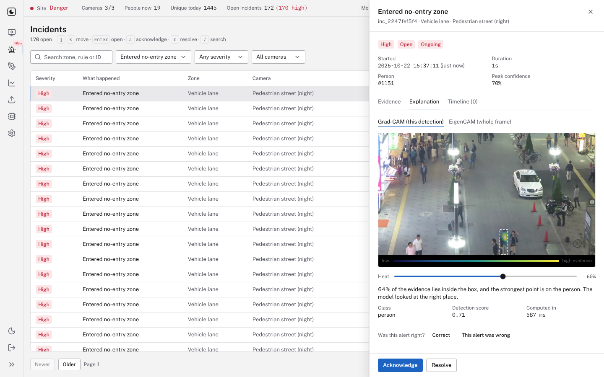
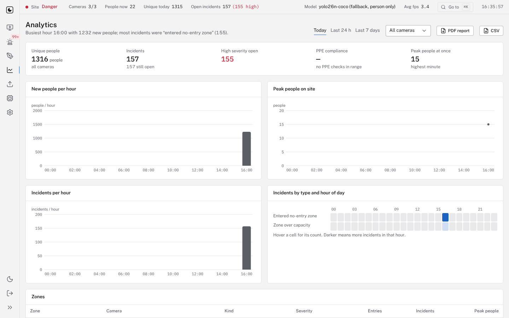

# Vision Sentinel 2.0

Real-time safety monitoring for industrial sites. It watches camera feeds, counts the distinct people on site,
checks each tracked person for PPE (helmet, vest, gloves, boots, goggles), raises incidents when someone enters a
no-entry zone or a hazard area is over its limits, and explains every alert with a heatmap of what the model looked
at. A rebuild from scratch of the v1 college prototype, with every claim backed by a measurement in this repository.


## Quick start

**With Docker** (any machine with Docker Compose):

```bash
git clone https://github.com/paramsn37-sketch/Vision_Sentinel_2.0_GMP.git && cd Vision_Sentinel_2.0_GMP
VS_ADMIN_PASSWORD='choose-a-password' docker compose up --build
```

Open http://localhost:8080 and sign in as `admin`. Three demo cameras play the sample clips in `data/samples/`.

**Without Docker** (Python 3.12 with [uv](https://docs.astral.sh/uv/), Node 22):

```bash
make setup                                   # backend and frontend dependencies
VS_ADMIN_PASSWORD='choose-a-password' make dev   # API on :8000, UI on http://localhost:5173
```

If you do not set `VS_ADMIN_PASSWORD`, a random password is written to `data/runtime/ADMIN_PASSWORD.txt` on first
start. The first start downloads the stock detector weights if `models/` has no trained model.

## What it does

| Feature | Status |
|---|---|
| Sources: video file, webcam, RTSP/HTTP stream, photo/video upload | Working |
| Person + PPE detection with a model trained for this project | Working; accuracy below the target, see results |
| Tracking and unique-person counting (confirmed tracks, not per-frame counts) | Working; ~20 % count error on MOT17, target 10 % not met |
| Per-person PPE state with temporal smoothing (worn / missing / unknown) | Working when a PPE model is active |
| Polygon zones: no entry, PPE required, max occupancy, max dwell, active hours | Working |
| Incidents: open → acknowledged → resolved, evidence frame, timeline, notes | Working |
| Explanations: Grad-CAM per detection, EigenCAM for the whole frame | Working |
| Analytics, PDF and CSV shift reports | Working |
| Single admin sign-in, audit log, CSRF protection, login throttling | Working |
| Zone editor with full keyboard support, undo/redo, live preview of who is inside | Working |
| Dark and light themes, WCAG 2.2 AA contrast, reduced motion respected | Working (axe: 0 serious issues) |
| Docker Compose, CI (lint, unit, browser tests, image build) | Working |

Face recognition, cross-camera re-identification and alert delivery by SMS/email are out of scope
([docs/ROADMAP.md](docs/ROADMAP.md)).

## Results

All numbers are measured by scripts in this repository on data it never trained on. The detector is evaluated on a
frozen test split of 559 images; counting on MOT17 sequences not used for tuning.

<!-- results:detector -->
**Detector, person class, test split (mAP50)**

| Model | Person mAP50 | PPE classes | CPU inference |
|---|---|---|---|
| v1 setup: YOLO11m, COCO weights | 0.745 | not detected | ~735 ms/image |
| Stock YOLO26n, COCO weights | 0.720 | not detected | ~183 ms/image |
| Ours: YOLO26n trained on person + PPE | evaluation pending | evaluation pending | evaluation pending |
<!-- /results:detector -->

**Unique-person counting, MOT17 (mean absolute count error, lower is better)**

| Method | Error |
|---|---|
| v1: people per frame, sampled once a second | 107.9 % |
| ByteTrack, default thresholds | 25.2 % |
| Ours: tuned ByteTrack + track confirmation | 20.0 % |

Details: [counting report](docs/eval/counting_report.md), [detector results](docs/eval/detector_results.json),
[model card](MODEL_CARD.md), [training report](training/reports/training_report.md).

## Screens

| | |
|---|---|
|  |  |
|  |  |

## Documentation

| Document | For |
|---|---|
| [User guide](docs/user-guide.md) | Safety officers and the admin: every screen and keyboard shortcut |
| [Operations](docs/operations.md) | Configuration reference, Docker, backups, retention, troubleshooting |
| [Architecture](docs/architecture.md) | Components, per-frame data flow, incident and zone state machines |
| [API](docs/api.md) | REST endpoints and WebSocket message formats |
| [Training](docs/training.md) | Adding data, retraining, evaluating and promoting a model (CPU, GPU or Colab) |
| [Report appendix](docs/report-appendix.md) | Problem, method, results and limitations, for the college report |
| [Final audit](docs/FINAL_AUDIT.md) | Every requirement of the blueprint with pass/fail and evidence |
| [Blueprint](docs/BLUEPRINT.md), [build log](docs/BUILD_LOG.md), [decisions](docs/DECISIONS.md) | How it was specified and built |

## Development

```bash
make lint        # ruff, oxlint
make typecheck   # mypy (vision core), tsc
make test        # pytest (fast suite) and vitest
make e2e         # Playwright, needs `make dev` running
make eval        # counting and explanation evaluations
```

## Licence

AGPL-3.0, matching Ultralytics YOLO which the detector is built on ([LICENSE](LICENSE), ADR-0002 in
[docs/DECISIONS.md](docs/DECISIONS.md)).
