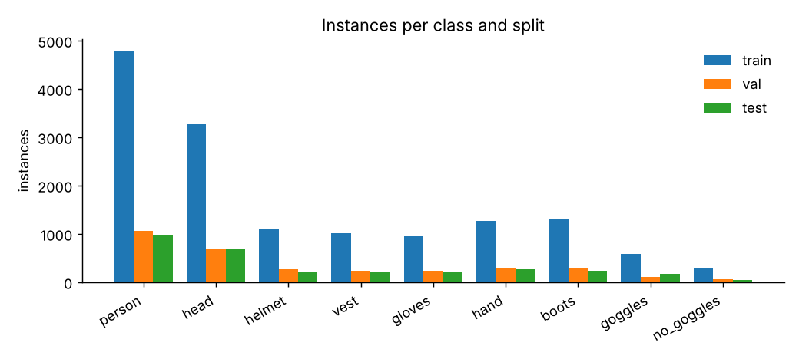
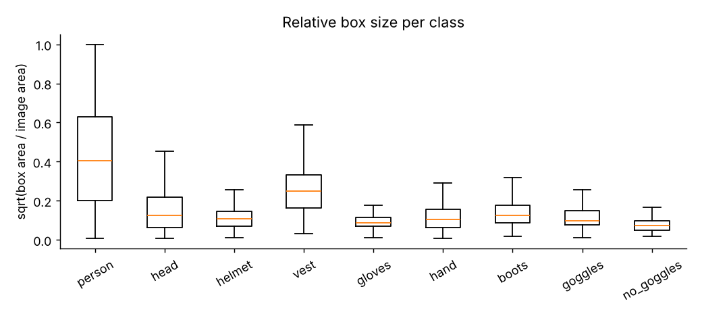

# Dataset card — Vision Sentinel PPE v2.0

Generated by `training/scripts/dataset_card.py`. Images are not committed; manifests are in `data/manifests/` (test split checksum in `test_manifest.sha256`).

## Taxonomy

| id | class | meaning |
|---|---|---|
| 0 | person | a person (whole or partly visible) |
| 1 | head | bare head, i.e. no hard hat |
| 2 | helmet | hard hat worn on a head |
| 3 | vest | high-visibility vest |
| 4 | gloves | gloved hand |
| 5 | hand | bare hand |
| 6 | boots | boots / safety footwear |
| 7 | goggles | eye protection worn |
| 8 | no_goggles | visible eyes without protection |

## Sources

| source | train | val | test | licence |
|---|---|---|---|---|
| construction_ppe | 883 | 188 | 191 | AGPL-3.0 (Ultralytics Construction-PPE) |
| openimages_v7 | 1712 | 366 | 368 | Annotations CC BY 4.0, images CC BY 2.0 (Open Images V7) |

Near-duplicates removed by perceptual hash (Hamming ≤ 6): **157**.
Open Images selection: {"person_cap": 1800, "ppe_cap": 300, "seed": 7, "workers": 24}; downloads failed: 0.

## Instances per class

| class | train | val | test | construction_ppe | openimages_v7 |
|---|---|---|---|---|---|
| person | 4788 | 1058 | 976 | 2098 | 4724 |
| head | 3277 | 697 | 681 | 485 | 4170 |
| helmet | 1104 | 273 | 205 | 1582 | 0 |
| vest | 1014 | 238 | 210 | 1462 | 0 |
| gloves | 957 | 229 | 208 | 1186 | 208 |
| hand | 1262 | 278 | 267 | 556 | 1251 |
| boots | 1306 | 297 | 230 | 1354 | 479 |
| goggles | 581 | 108 | 166 | 418 | 437 |
| no_goggles | 307 | 55 | 49 | 411 | 0 |

## Image sizes

3708 images; height median 643 px (min 263, max 1024), width median 960 px (min 348, max 1024).
Open Images were downscaled to a 960 px long side at download time.

## Known gaps and biases

- `vest`, `helmet`, `no_goggles` come only from Construction-PPE (construction sites, daylight, mostly frontal).
- Open Images labels are not exhaustive: an Open Images image can contain an unlabelled glove or hand. This adds label noise for `gloves`/`hand`; heads are labelled whenever the image was selected (selection rule).
- Images labelled with sport/bicycle helmets were excluded, so motorbike helmets are unseen (may be confused with hard hats).
- No face-mask class: no reachable source in the build environment (ADR-0006).
- Few night, rain or thermal scenes; no top-down CCTV angles. Expect lower accuracy there.
- Kaggle SH17 and Roboflow sets were not reachable (network policy), see ADR-0004.

## Licence implications

Construction-PPE is AGPL-3.0 and Open Images is CC BY; trained weights are released under AGPL-3.0 with attribution to both sources.

## QA grids

Random labelled training crops per class: `data/figures/qa_<class>.jpg`.
