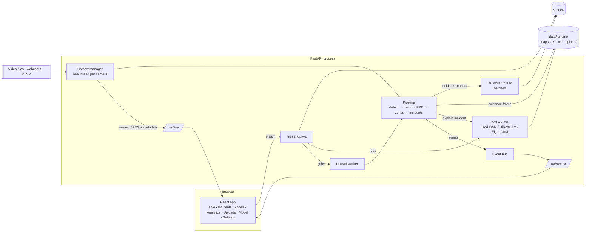
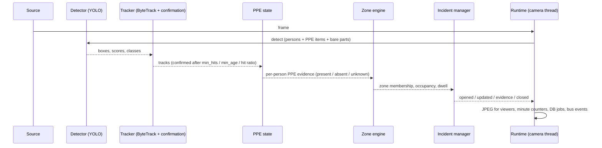
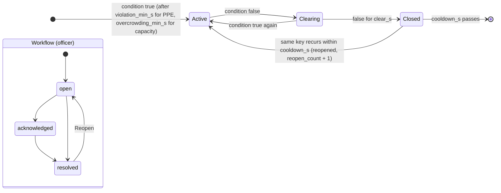
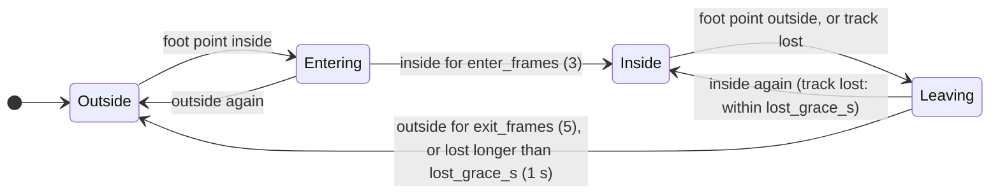

# Architecture

Vision Sentinel is one Python process (FastAPI) that owns the camera pipelines and the API, and one static React app
that talks to it over REST and two WebSockets. SQLite stores everything durable. There is no broker, cache server or
second database (blueprint §3.1).

## Components

Source layout: `backend/app/core/` is the vision core with no web dependencies (it also runs from the CLI,
`python -m app.core.cli`); `backend/app/services/` wires it to cameras, the database and the bus;
`backend/app/api/` is the HTTP and WebSocket surface; `frontend/src/` is the UI.

## Per-frame data flow

* **Detection.** One model detects people and PPE items. Without a trained model the COCO nano model runs in
  person-only mode and PPE checks are switched off (no false "missing" alerts; `checkable_items`).
* **Tracking and counting.** ByteTrack with Vision Sentinel's confirmation step: a track counts as a person only after
  `min_hits` matched frames, `min_age_s` seconds, and a hit ratio of at least `min_hit_ratio`. "Unique" means
  distinct confirmed tracks; v1 summed per-frame detections. Thresholds and their measured effect:
  `docs/eval/counting_report.md`, ADR-0009.
* **PPE.** Item boxes are assigned to a person by intersection over the item area within the head or torso region.
  Each item's evidence is an exponentially filtered score with hysteresis (`absent_below` / `present_above`), so one
  missed detection never flips the state. Absence is only concluded from a bare-part detection (for example `head`
  without `helmet`) or, for the vest, from a clear full-body view.
* **Zones.** Membership uses the foot point (bottom-centre, raised slightly) and point-in-polygon on normalised
  coordinates, with entry and exit hysteresis (below).
* **Incidents.** Conditions are keyed by (person, rule, zone); one incident per key while the condition holds, so
  alerts are de-duplicated by construction.
* **Explanations.** On incident, the evidence frame is explained in the background for the detection that triggered
  it (Grad-CAM family on the detection-head branch that produced the box, ADR-0010). Operators can also request one
  from a paused live frame or an upload.

## Incident state machine

Two independent axes: whether the condition is still happening (`active`), and the officer workflow (`status`).

Defaults: `clear_s` 3 s, `cooldown_s` 30 s, `overcrowding_min_s` 2 s, PPE `violation_min_s` 2 s.

## Zone membership hysteresis

Dwell time accumulates only while `Inside`. Occupancy is the number of people `Inside`.

## Persistence

* SQLite in WAL mode. All writes go through one writer thread that batches jobs; a failing batch is retried job by
  job so one bad row cannot drop others. Schema is created with `create_all` and versioned with `user_version`
  (ADR-0011).
* Tables: users, cameras, zones, incidents (with notes and feedback), zone events, track summaries, counts per
  camera per minute, uploads, settings (threshold overrides) and an audit log.
* Files under `data/runtime/`: `snapshots/` (evidence frames), `xai/` (heatmaps, overlays, source frames),
  `uploads/`, `exports/`, `feedback/`. Retention deletes snapshots and explanations after `retention_days`.
  Evidence writing stops (and one system alert is raised) when less than 200 MB of disk is free.

## Live streaming protocol

`/ws/live?camera_id=…&fps=…` sends, for every frame, a JSON text message followed by the JPEG of the same frame as a
binary message. Metadata coordinates are in original frame pixels; the JPEG may be downscaled
(`stream_max_width`), so the UI scales overlays by `width`/`height` from the metadata. The UI draws boxes, IDs, PPE
and zones itself on a canvas, so overlay layers toggle without a server round trip. Slow clients get fewer frames,
never a backlog. Message formats are in [api.md](api.md).

## Security

Single admin account (argon2 hash), signed session cookie (HttpOnly, SameSite=Lax) plus a double-submit CSRF token
for every state-changing request, login throttling on failed attempts, CORS restricted to the UI origin, upload size
and type limits, file endpoints that resolve paths from database ids only, and `X-Frame-Options`/`nosniff` headers.
`backend/tests/api/test_security.py` checks that every route except health, metrics and login rejects anonymous
requests.
