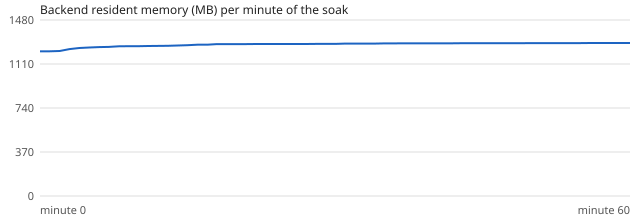

# Soak test

Generated by `scripts/soak.py`: 60 minutes, 3 looping file cameras, sampled once a minute.

**Memory growth after warm-up (minute 5 → 60): +3.0%** (within the 10 % limit). Open files 24–24, threads 52–52. Cameras that stopped advancing: none.

| minute | RSS MB | open files | threads | DB MB | fps per camera |
|---|---|---|---|---|---|
| 0 | 1217.2 | 24 | 52 | 5.68 | ppe-check 3.1, street-night 3.1, town-square 3.1 |
| 5 | 1249.0 | 24 | 52 | 5.91 | ppe-check 3.8, street-night 3.9, town-square 3.9 |
| 10 | 1259.5 | 24 | 52 | 6.15 | ppe-check 3.7, street-night 3.8, town-square 3.7 |
| 15 | 1268.5 | 24 | 52 | 6.43 | ppe-check 3.9, street-night 3.9, town-square 3.9 |
| 20 | 1277.6 | 24 | 52 | 6.67 | ppe-check 3.7, street-night 3.7, town-square 3.7 |
| 25 | 1278.4 | 24 | 52 | 6.95 | ppe-check 4.1, street-night 4.1, town-square 4.1 |
| 30 | 1278.9 | 24 | 52 | 7.19 | ppe-check 3.7, street-night 3.7, town-square 3.8 |
| 35 | 1283.5 | 24 | 52 | 7.48 | ppe-check 3.8, street-night 3.8, town-square 3.8 |
| 40 | 1284.3 | 24 | 52 | 7.71 | ppe-check 3.8, street-night 3.8, town-square 3.8 |
| 45 | 1284.8 | 24 | 52 | 8.0 | ppe-check 4.1, street-night 4.1, town-square 4.1 |
| 50 | 1285.6 | 24 | 52 | 8.27 | ppe-check 4.0, street-night 4.0, town-square 4.0 |
| 55 | 1286.2 | 24 | 52 | 8.5 | ppe-check 3.9, street-night 3.9, town-square 3.9 |
| 60 | 1287.0 | 24 | 52 | 8.79 | ppe-check 3.8, street-night 3.8, town-square 3.8 |

Measured while detector training was using the same CPU, so the frame rates above are lower than on an idle
machine; see `performance.md` for throughput. The soak checks stability (memory, handles, threads), not speed.
