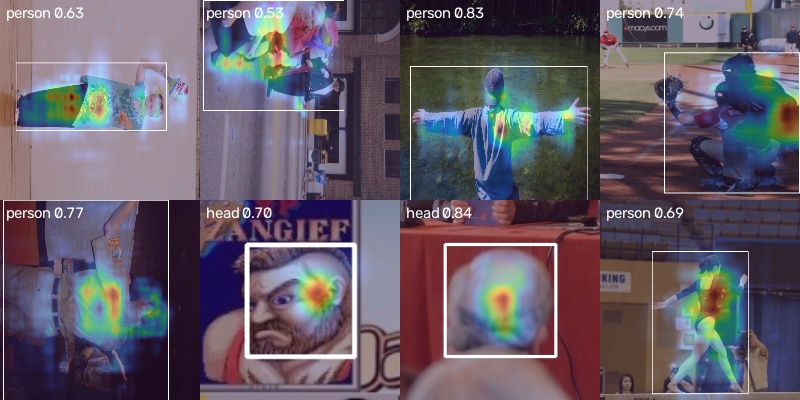

# Explainability evaluation

Generated by `backend/eval/xai_eval.py`. Model: **vs2-y26n.pt**; method: **hirescam** (per-detection,
see `backend/app/core/xai/cam.py`). 214 detections from the frozen test split, balanced by class.
Hardware: the build container's CPU (no GPU).

## Pointing game

Share of explanations whose hottest pixel lies inside the explained box: **100.0%**.

| class | n | pointing game | heat inside box |
|---|---|---|---|
| person | 33 | 100.0% | 95.5% |
| head | 33 | 100.0% | 94.3% |
| helmet | 33 | 100.0% | 94.0% |
| vest | 33 | 100.0% | 96.3% |
| boots | 33 | 100.0% | 93.0% |
| goggles | 21 | 100.0% | 98.6% |
| hand | 7 | 100.0% | 96.9% |
| gloves | 21 | 100.0% | 94.7% |

Method comparison on the first 60 detections (pointing game):

| method | pointing game |
|---|---|
| hirescam (default) | 100.0% (all classes, mean of class rates) |
| classic Grad-CAM (averaged gradients) | 63.3% |
| EigenCAM (gradient-free, not detection-specific) | 16.7% |

## Deletion check

Over 100 detections, graying out the hottest 20% of pixels lowered the detection score by
**0.509** on average, versus **0.109** for a random 20%.
The heatmap region mattered more than a random region in **95%** of cases.

## Model randomisation check

Mean SSIM between maps of the trained model and a model with re-initialised conv weights: **0.669**
over 30 detections (below 0.5 means the explanation depends on what the model learned).

**Result: fail.** Maps from the randomised model still resemble the trained model's. Part of every map's shape comes from *where* the explained box is (the method back-propagates from the anchors that produced that box, and a random network's anchors there respond to local edges), not only from what the model learned. Read the pointing-game numbers with that in mind; the deletion check above is the stronger evidence that the hot region matters to the trained model's score.

## Latency

p50 **142 ms**, p95 **224 ms** per explanation on the build
machine's CPU. The blueprint's 300 ms target is for a GPU, which was not available (not measured).

## Examples

