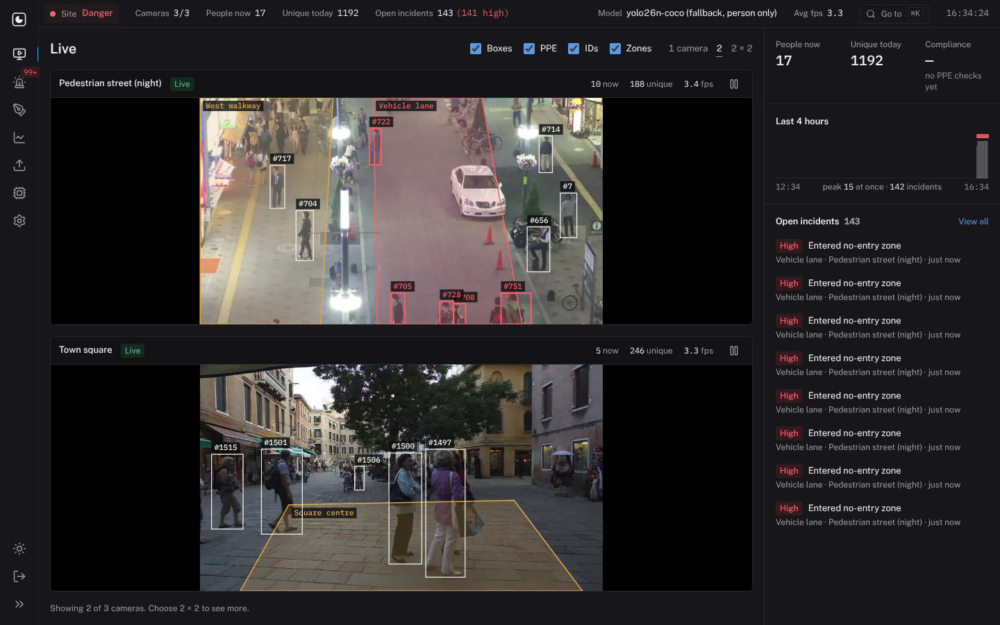
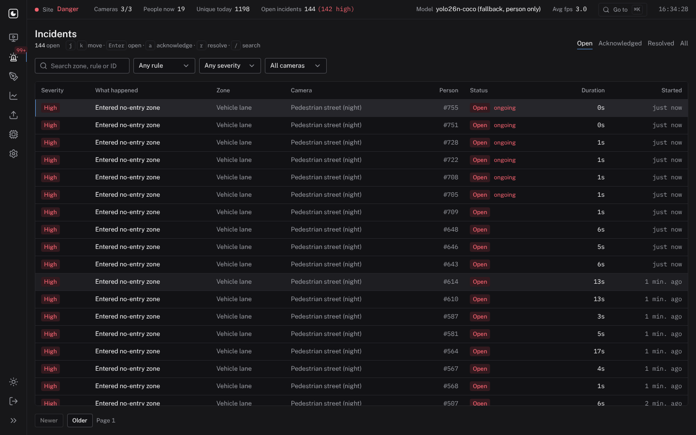
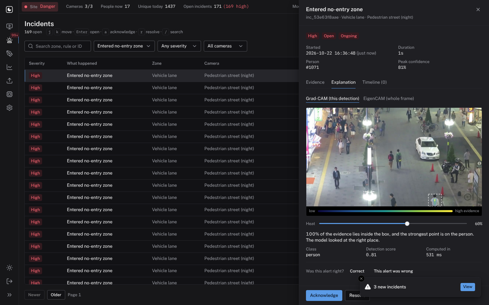
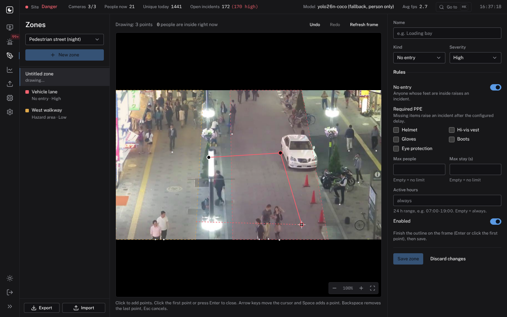
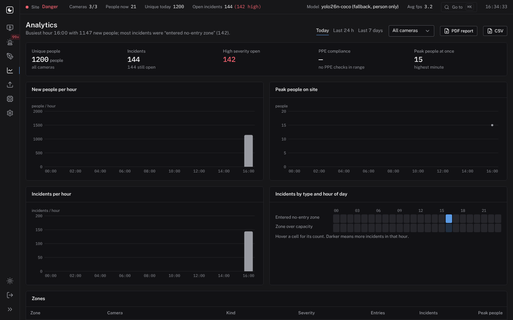
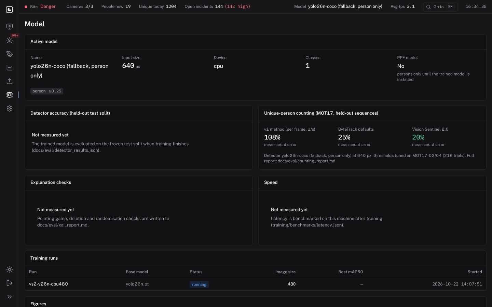

# User guide

For safety officers who watch the cameras and handle incidents, and for the admin who sets the system up. Screens
are shown in the dark theme; the moon/sun button at the bottom of the left rail switches theme.

## Signing in

Open the address your admin gave you (with Docker on the same machine: http://localhost:8080) and sign in as
`admin`. Five wrong passwords from one machine within a minute lock sign-in for a minute.

## Moving around

* The left rail has one icon per screen; hover for its name. `[` expands the rail with labels.
* `⌘K` / `Ctrl+K` opens **Go to**: type a screen, camera or command.
* `g` then a number jumps to a screen: `g 1` Live, `g 2` Incidents, `g 3` Zones, `g 4` Analytics, `g 5` Uploads,
  `g 6` Model, `g 7` Settings.
* The strip along the top is always visible: site status (Normal, Warning, Danger), cameras online, people on site
  now, unique people today, open incidents, the active model and average frame rate. On small screens it shows
  fewer items.

## Live

* Each tile is one camera. Boxes are people the system has **confirmed** (seen steadily for a moment), with their
  ID. A red box means the person is in a no-entry zone or missing required PPE.
* The tick boxes at the top switch layers: boxes, PPE labels, IDs, zones.
* **1 camera / 2 / 2 × 2** sets the wall layout.
* Click a person to open their card (ID, time on camera, zones, PPE state). The pause button (or `Space`) freezes
  a tile; on a frozen frame **Explain** shows what the model looked at for that person (see Incident details).
* The right panel shows today's counts, the last four hours (hours with no camera running are left blank, not
  zero) and open incidents. New incidents slide in at the top and appear as a notification.

"Unique today" counts distinct confirmed people since midnight. The demo cameras play short clips in a loop, so on
the demo every loop counts as new people.

## Incidents

* Filter by status (Open, Acknowledged, Resolved, All), rule, severity and camera, or search by zone, rule or ID.
* Keyboard: `j`/`k` move, `Enter` opens, `a` acknowledges, `r` resolves, `/` jumps to search.
* "ongoing" means the condition is still happening right now. The workflow status is yours to set.
* An incident opens once per person, rule and zone. If the same thing happens again within 30 seconds the same
  incident reopens instead of creating a new one.

### Incident details

Click a row to open the drawer:

* **Evidence**: the frame saved when the incident opened (heads can be blurred by a privacy setting).
* **Explanation**: a heatmap of what the model looked at for this detection, with an opacity slider. Grad-CAM
  explains this one detection; EigenCAM shows what the network attends to in the whole frame. The sentence under the
  image says how much of the evidence lies inside the person's box. If the model was looking somewhere else, treat
  the alert with care. **This alert was wrong** records feedback for retraining.
* **Timeline**: what happened and who did what. Add a note for the next shift.
* **Acknowledge** when you are dealing with it; **Resolve** when it is closed. **Reopen** brings it back.

## Zones

Zones are drawn on a still frame from the camera. A person is inside a zone when their **feet** are inside it, so
draw zones on the floor.

1. Pick the camera, then **New zone**.
2. Click to place points. Close the outline by clicking the first point or pressing `Enter`. The outline cannot
   cross itself; the editor tells you if a point would make it cross.
3. Give the zone a name, a kind and a severity:
   * **No entry**: anyone inside raises an incident.
   * **PPE required**: people inside must wear the ticked items.
   * **Hazard area**: set a maximum number of people and/or a maximum stay.
   * **Active hours** limits the rules to a time range, for example `07:00-19:00`.
4. **Save zone**. The running camera uses it from the next frame; no restart.

While editing: drag a point to move it, click an edge to add a point, drag inside to move the whole zone, `Delete`
removes the selected point, `[` and `]` select points, arrow keys nudge (`Shift` for bigger steps), `Ctrl+Z` /
`Ctrl+Shift+Z` undo and redo. Scroll or use the `+`/`−` buttons to zoom, hold `Space` and drag to pan. The whole
editor works from the keyboard: arrow keys move the cross-hair and `Space` places a point.

The white dots are the feet of people in the latest frame; red dots are inside the zone you are drawing, and the
count above the frame tells you how many people the zone would contain right now.

**Export** and **Import** move zones between cameras or sites as YAML.

## Analytics

Choose Today, Last 24 h or Last 7 days and a camera. The summary sentence names the busiest hour and the most common
incident. Charts: new people per hour, peak people on site, incidents per hour, incidents by type and hour of day,
and a table per zone. **PDF report** and **CSV** download the same numbers.

## Uploads

Drop a photo or video (JPG, PNG, MP4, MOV, AVI, MKV, WebM, up to 200 MB). It runs through the same detection,
tracking and PPE checks as a live camera. You get the unique people count, PPE findings and an annotated copy to
download. Nothing is sampled or simulated; long videos take as long as the machine needs.

## Model

What the active detector is, which classes it knows and its per-class thresholds, its measured accuracy on the
held-out test split, the counting evaluation, and the explanation checks. "Not measured yet" means exactly that.

## Settings (admin)

* **Cameras**: add a video file, a webcam (index such as `0`) or an RTSP/HTTP stream. **Test** opens the source once
  and shows a frame or the exact error. Disabled cameras stop processing.
* **Thresholds**: every counting, PPE, zone and incident threshold with a one-line explanation. Changes apply to
  running cameras immediately. [operations.md](operations.md) has the full reference.
* **Password**: at least 8 characters.
