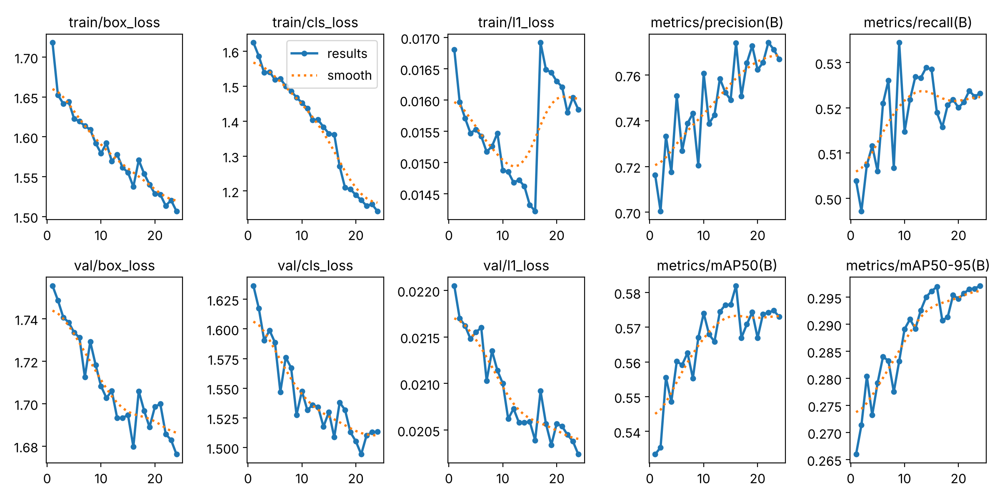

# Training report: vs2-y26n

What was trained, how, and how well it does. The shipped model `vs2-y26n` came out of two CPU training stages:

| stage | run | start point | epochs | time | test mAP50 (9 classes) | status |
|---|---|---|---|---|---|---|
| 1 | `vs2-y26n-cpu480` | `yolo26n.pt` (COCO) | 26 (interrupted) | 3.8 h | 0.524 | superseded |
| 2 | `vs2-y26n-cpu480-ft` | stage 1's best weights | 24 (complete) | 2.1 h | **0.568** | **promoted** |

Numbers come from `training/registry.json`, `training/runs/<run>/results.csv`, `docs/eval/detector_results.json`,
`training/benchmarks/latency.json` and `training/reports/error_analysis/`. Console logs of every run and evaluation
are in [`training/logs/`](../logs/README.md). The model card ([`MODEL_CARD.md`](../../MODEL_CARD.md)) is the short
version.

# Stage 2: `vs2-y26n-cpu480-ft` (shipped)

## Setup

| | |
|---|---|
| Start point | stage 1's promoted weights (`models/vs2-y26n.pt` at commit `c99ca8f`) |
| Data | identical to stage 1: `data/merged`, manifest hash `959596097b843262`, same frozen splits |
| Hyperparameters | [`hyp_cpu_finetune.yaml`](../configs/hyp_cpu_finetune.yaml): 480 px, batch 16, 24 epochs, AdamW lr 0.0008 cosine-decayed to 5 %, 1 warm-up epoch, mosaic 1.0 (off for the last 8 epochs), flips, HSV jitter, seed 0 |
| Why a new schedule | resuming stage 1 would restore its 8-hour schedule with the learning rate near its peak; a short decaying schedule with mosaic-off epochs is what stage 1 never got (ADR-0014) |
| Hardware and software | same as stage 1 |
| Run | 2026-10-23, 04:56–07:07 UTC, in two parts (epochs 1–21, then resumed for 22–24 with `train.py --resume`), because one job on the build machine may run for at most about two hours |
| Console log | [`2026-10-23_vs2-y26n-cpu480-ft_train.log`](../logs/2026-10-23_vs2-y26n-cpu480-ft_train.log) |

## Learning curves

Validation by epoch (`training/runs/vs2-y26n-cpu480-ft/results.csv`):

| epoch | 1 | 4 | 8 | 10 | 13 | 16 | 17 (mosaic off) | 20 | 22 | 24 |
|---|---|---|---|---|---|---|---|---|---|---|
| mAP50 | 0.533 | 0.549 | 0.555 | 0.574 | 0.574 | 0.582 | 0.567 | 0.567 | 0.574 | 0.573 |
| mAP50-95 | 0.266 | 0.273 | 0.278 | 0.289 | 0.293 | 0.297 | 0.291 | 0.295 | 0.297 | **0.297** |

Epoch 1 dips below stage 1's 0.539 (warm-up re-raises the learning rate), then the curve climbs past it by epoch 3.
mAP50-95, which drives Ultralytics' choice of best epoch, was highest at epoch 24, so the last epoch is the shipped
one. Over the last 8 epochs (mosaic off, low learning rate) mAP50 is flat around 0.57 and mAP50-95 creeps up: the
model has converged for this size, data and input resolution. More CPU epochs of this kind would add little; a
larger model or input size on a GPU is the next step.

## Test results

Frozen test split (559 images, 2,992 boxes). Per-class thresholds chosen on validation. Plots in
[`eval/vs2-y26n-cpu480-ft/`](eval/vs2-y26n-cpu480-ft/) (test) and
[`eval/vs2-y26n-cpu480-ft-val/`](eval/vs2-y26n-cpu480-ft-val/) (validation). Evaluation log:
[`2026-10-23_vs2-y26n-cpu480-ft_eval.log`](../logs/2026-10-23_vs2-y26n-cpu480-ft_eval.log).

| class | P | R | mAP50 | mAP50-95 | stage 1 mAP50 | change |
|---|---|---|---|---|---|---|
| person | 0.752 | 0.684 | 0.726 | 0.404 | 0.683 | +0.043 |
| head | 0.765 | 0.596 | 0.644 | 0.366 | 0.579 | +0.065 |
| helmet | 0.885 | 0.849 | 0.901 | 0.500 | 0.867 | +0.034 |
| vest | 0.858 | 0.832 | 0.888 | 0.548 | 0.849 | +0.039 |
| gloves | 0.752 | 0.495 | 0.555 | 0.261 | 0.514 | +0.041 |
| hand | 0.525 | 0.176 | 0.222 | 0.092 | 0.150 | +0.072 |
| boots | 0.734 | 0.617 | 0.696 | 0.369 | 0.683 | +0.013 |
| goggles | 0.747 | 0.392 | 0.450 | 0.173 | 0.380 | +0.070 |
| no_goggles | 1.000 (no detections) | 0.000 | 0.034 | 0.008 | 0.016 | +0.018 |
| **all** | 0.780 | 0.516 | **0.568** | **0.302** | 0.524 | **+0.044** |

Every class improved. Validation (all classes): P 0.766, R 0.525, mAP50 0.573, mAP50-95 0.297; test and
validation agree within 0.5 points. Promotion rule (ADR-0014): promote only if better on test than stage 1. It is,
on the mean and on every class, so it was promoted as `vs2-y26n`.

### Comparison

| model | person mAP50 | person mAP50-95 | person P / R | PPE |
|---|---|---|---|---|
| v1 setup: YOLO11m COCO, 640 px | 0.745 | 0.424 | 0.732 / 0.791 | none |
| Stock YOLO26n COCO, 640 px | 0.720 | 0.387 | 0.741 / 0.743 | none |
| stage 1, 480 px | 0.683 | 0.368 | 0.690 / 0.702 | helmet 0.867, vest 0.849 |
| **vs2-y26n (stage 2), 480 px** | **0.726** | **0.404** | 0.752 / 0.684 | helmet 0.901, vest 0.888, boots 0.696, head 0.644 |

Stage 2 recovers the person quality lost in stage 1: it now beats the stock nano model (0.726 vs 0.720 mAP50,
0.404 vs 0.387 mAP50-95) at a smaller input size, and is 1.9 points behind the 8× larger v1 model.

## Speed

Same architecture and input size as stage 1, so the same work per image. Re-measured on 2026-10-23
([`latency.json`](../benchmarks/latency.json), log
[`2026-10-23_vs2-y26n-ft_benchmark.log`](../logs/2026-10-23_vs2-y26n-ft_benchmark.log)): PyTorch 32.0 ms p50 at
480 px (52.1 ms at 640); ONNX Runtime 23.1 ms at 480 px (36.6 ms at 640). The build machine was re-provisioned
between the two days and is noisier now; on the same machine, 200 frames each, stage 1 weights measured 35.7 ms
and stage 2 weights 39.8 ms p50 in one back-to-back run, which is within this machine's run-to-run variation for
identical networks. GPU not measured.

## Error analysis

Re-run for the shipped model ([`error_analysis.py`](../scripts/error_analysis.py), operating thresholds, IoU ≥ 0.5):
[50 most confident false positives](error_analysis/fp_grid.jpg), [50 largest misses](error_analysis/fn_grid.jpg),
[every error](error_analysis/errors.csv), [counts](error_analysis/summary.json).

| class | FP stage 2 | FN stage 2 | FP stage 1 | FN stage 1 |
|---|---|---|---|---|
| person | 233 | 299 | 209 | 352 |
| head | 184 | 259 | 177 | 302 |
| hand | 196 | 187 | 136 | 212 |
| gloves | 25 | 105 | 39 | 107 |
| goggles | 9 | 113 | 25 | 114 |
| boots | 75 | 83 | 73 | 86 |
| no_goggles | 46 | 44 | 88 | 46 |
| helmet | 24 | 33 | 40 | 36 |
| vest | 21 | 44 | 24 | 46 |

Misses fell for every class. False positives fell for helmet, vest, gloves, goggles and no_goggles, and rose for
person, head and hand, where the validation-chosen thresholds are now lower (person 0.287, head 0.186, hand 0.098)
and recall is bought with some precision. The stage-2 grids show the same patterns as stage 1 (below): the most
confident "false" people are mostly real people that the labels left out, a hard hat on its own is still the most
confident helmet false positive, and the largest misses are partial bodies (feet, legs, hands, close-up faces) and
close-up gloves. A few whole workers in vests and helmets appear among the person misses; in those images the
person label boxes a different extent than the prediction, so IoU falls below 0.5.

# Stage 1: `vs2-y26n-cpu480` (superseded)

## Setup

| | |
|---|---|
| Start point | `yolo26n.pt` (COCO), 2.39 M parameters |
| Data | `data/merged`, manifest hash `959596097b843262`: 2,595 train / 554 val / 559 test images, 9 classes ([dataset card](../../data/DATASET_CARD.md)) |
| Hyperparameters | [`hyp_cpu_budget.yaml`](../configs/hyp_cpu_budget.yaml): 480 px, batch 16, AdamW lr 0.002 with cosine decay, mosaic 1.0 (off for the last 5 epochs), flips, HSV jitter, 8 h time budget, patience 15, seed 0 |
| Hardware | 4-core Intel Xeon 2.10 GHz, no GPU (ADR-0004, ADR-0007) |
| Software | Python 3.12.13, torch 2.14.1, Ultralytics 8.4.183 |
| Git commit at start | `5f50cc5` |

### What happened

The run started at 14:07 UTC with an 8-hour budget, which Ultralytics turns into an epoch count and fits the
learning-rate schedule to. After 26 epochs (3.79 h) the build machine was restarted and the training process did not
survive. The registry records the run as `interrupted`. The checkpoint from epoch 26 is the shipped model: it is
also the best epoch by validation fitness. Because the schedule was planned for about twice as many epochs, the
learning rate had not decayed and the mosaic-off fine-tuning epochs never ran, so this model is **under-trained**.
The time budget was not resumed because Ultralytics would restart the 8-hour clock, and the remaining build work
needed the CPU.

## Learning curves (stage 1)

Validation mAP50 by epoch:

| epoch | 1 | 5 | 10 | 15 | 18 | 20 | 22 | 24 | 26 |
|---|---|---|---|---|---|---|---|---|---|
| mAP50 | 0.268 | 0.410 | 0.446 | 0.503 | 0.512 | 0.521 | 0.525 | 0.539 | 0.539 |

Still rising, slowly: +2.7 points over the last 8 epochs. Training losses and the validation classification loss
were still falling (val cls 1.742 at epoch 18, 1.624 at epoch 26); the validation box loss had flattened around
1.76–1.80 from epoch 21. No sign of over-fitting yet.

## Test results (stage 1)

Frozen test split (559 images, 2,992 boxes). Thresholds chosen on validation. Plots: PR, F1, P, R curves and
confusion matrices in [`eval/vs2-y26n-cpu480/`](eval/vs2-y26n-cpu480/); the same plots on validation in
[`eval/vs2-y26n-cpu480-val/`](eval/vs2-y26n-cpu480-val/).

| class | P | R | mAP50 | mAP50-95 |
|---|---|---|---|---|
| person | 0.690 | 0.702 | 0.683 | 0.368 |
| head | 0.654 | 0.602 | 0.579 | 0.315 |
| helmet | 0.785 | 0.839 | 0.867 | 0.454 |
| vest | 0.807 | 0.814 | 0.849 | 0.503 |
| gloves | 0.764 | 0.468 | 0.514 | 0.232 |
| hand | 0.444 | 0.060 | 0.150 | 0.058 |
| boots | 0.737 | 0.591 | 0.683 | 0.375 |
| goggles | 0.633 | 0.319 | 0.380 | 0.138 |
| no_goggles | 1.000 (no detections) | 0.000 | 0.016 | 0.004 |
| **all** | 0.724 | 0.488 | **0.524** | 0.272 |

Validation (for reference, all classes): P 0.719, R 0.504, mAP50 0.539, mAP50-95 0.270. Test and validation agree
within 1.5 points, so thresholds chosen on validation should transfer.

### Comparison (stage 1)

| model | person mAP50 | person mAP50-95 | person P / R | PPE |
|---|---|---|---|---|
| v1 setup: YOLO11m COCO, 640 px | 0.745 | 0.424 | 0.732 / 0.791 | none |
| Stock YOLO26n COCO, 640 px | 0.720 | 0.387 | 0.741 / 0.743 | none |
| **stage 1, 480 px** | **0.683** | 0.368 | 0.690 / 0.702 | helmet 0.867, vest 0.849, boots 0.683, head 0.579 |

Fine-tuning cost 3.7 points of person mAP50 against the stock nano model (inside the 5-point allowance) and bought
PPE detection, which neither COCO model has. Part of the person gap is the smaller input (480 vs 640 px); part is
that 26 epochs of a 9-class head have not recovered COCO's person quality.

## Speed (stage 1)

CPU, one image per call including pre- and post-processing, measured 2026-10-22:
PyTorch 29.9 ms p50 at 480 px (44.1 ms at 640); ONNX Runtime 27.6 ms at 480 px (35.6 ms at 640). GPU not measured.

## Error analysis (stage 1)

From the stage-1 run of [`error_analysis.py`](../scripts/error_analysis.py) (log
[`2026-10-22_vs2-y26n_error_analysis.log`](../logs/2026-10-22_vs2-y26n_error_analysis.log); the files in
`error_analysis/` now hold the stage-2 results). Recall and mAP figures quoted here are stage 1's.

| class | false positives | false negatives |
|---|---|---|
| person | 209 | 352 |
| head | 177 | 302 |
| hand | 136 | 212 |
| gloves | 39 | 107 |
| goggles | 25 | 114 |
| boots | 73 | 86 |
| no_goggles | 88 | 46 |
| helmet | 40 | 36 |
| vest | 24 | 46 |

What the grids show:

1. **Many confident "false positive" people are real people.** Of the 50 most confident person false positives,
   most are clearly visible people (portraits, workers in vests, a nurse holding a baby). Open Images does not box
   every person, and groups are sometimes boxed as one. Part of the person gap is label noise, not model error.
2. **The largest misses are partial bodies.** Missed `person` boxes are mostly crops where only feet, legs, hands or
   a face fills the frame. Open Images labels these as `person`; the model, trained mostly on whole bodies, does not.
   On CCTV footage this matters less, because people appear whole.
3. **`head` errors cluster on close-up faces and unusual heads.** Painted faces, masks, babies and very large
   faces are missed; faces under caps or beanies are sometimes predicted as `head` where the label put the box
   elsewhere. A worker in a cap correctly counts as a bare head for helmet compliance.
4. **Hard hats that are not worn trigger `helmet`.** The most confident helmet false positive is a hard hat on its
   own. The PPE logic only credits a helmet that overlaps the person's head region, which limits the impact.
5. **Orange coveralls are mistaken for vests.** Two of the confident vest false positives are high-visibility
   jackets or coveralls, which arguably satisfy the same rule but are not labelled `vest`.
6. **Gloves are missed in close-up product-style photos** (one gloved hand filling the frame, fingerless gloves).
   Recall 0.47 at a precision of 0.76: when the model says gloves, it is usually right.
7. **`hand` is effectively not learned** (recall 0.06). Hands are small, often occluded, and Open Images labels them
   inconsistently. Since "missing gloves" needs a visible bare hand, glove violations will rarely fire; the system
   reports gloves as "unknown" instead, which is the honest state.
8. **`no_goggles` has too little data** (307 train boxes, all from one source) and scores 0.016 mAP50. Goggle
   violations should not be relied on with this model.
9. **Boots close-ups are missed** the same way as other partial views; boots on whole people are found.

# What to do next

1. Run the full GPU plan (`hyp_gpu_full.yaml`: YOLO26s, 640 px, 150 epochs) on Colab with
   [`train_colab.ipynb`](../notebooks/train_colab.ipynb). Stage 2 converged for a nano model at 480 px on CPU, so
   the next gain needs a larger model or input size.
2. Add CCTV-style data with complete labels (SH17, site footage) and drop or relabel Open Images close-ups.
3. Merge or drop the `hand` and `no_goggles` classes unless better data is found.
4. Add "hard hat not worn" and "hi-vis jacket" as hard negatives or as accepted vest variants.

# Effect on counting

Measured with stage 1's weights and not re-run for stage 2, because the app's counting does not use this model's
person class (ADR-0013). With stage 1's own `person` class the MOT17 unique-count error was 41.3 % at 480 px and 32.9 % at 640 px,
against 20.0 % with the stock COCO model: the fine-tuning data has few small, distant pedestrians. The app therefore
takes people from the COCO model and PPE from this one (ADR-0013). Better pedestrian data (CCTV-style, crowds) is
needed before this model can replace the COCO person detector.
