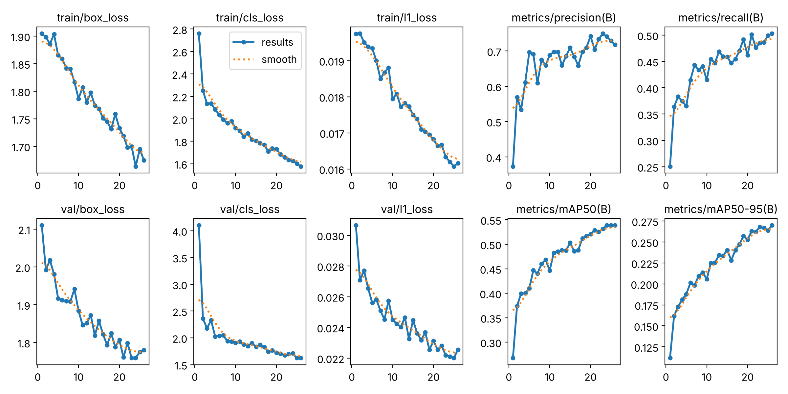

# Training report: vs2-y26n-cpu480

What was trained, how, and how well it does. Numbers come from `training/registry.json`,
`training/runs/vs2-y26n-cpu480/results.csv`, `docs/eval/detector_results.json`, `training/benchmarks/latency.json`
and `training/reports/error_analysis/`. The model card ([`MODEL_CARD.md`](../../MODEL_CARD.md)) is the short version.

## Setup

| | |
|---|---|
| Start point | `yolo26n.pt` (COCO), 2.39 M parameters |
| Data | `data/merged`, manifest hash `959596097b843262`: 2,595 train / 554 val / 559 test images, 9 classes ([dataset card](../../data/DATASET_CARD.md)) |
| Hyperparameters | [`hyp_cpu_budget.yaml`](../configs/hyp_cpu_budget.yaml): 480 px, batch 16, AdamW lr 0.002 with cosine decay, mosaic 1.0 (off for the last 5 epochs), flips, HSV jitter, 8 h time budget, patience 15, seed 0 |
| Hardware | 4-core Intel Xeon 2.10 GHz, no GPU (ADR-0004, ADR-0007) |
| Software | Python 3.12.13, torch 2.14.1, Ultralytics 8.4.183 |
| Git commit at start | `5f50cc5` |

### What happened

The run started at 14:07 UTC with an 8-hour budget, which Ultralytics turns into an epoch count and fits the
learning-rate schedule to. After 26 epochs (3.79 h) the build machine was restarted and the training process did not
survive. The registry records the run as `interrupted`. The checkpoint from epoch 26 is the shipped model: it is
also the best epoch by validation fitness. Because the schedule was planned for about twice as many epochs, the
learning rate had not decayed and the mosaic-off fine-tuning epochs never ran, so this model is **under-trained**.
The time budget was not resumed because Ultralytics would restart the 8-hour clock, and the remaining build work
needed the CPU.

## Learning curves

Validation mAP50 by epoch:

| epoch | 1 | 5 | 10 | 15 | 18 | 20 | 22 | 24 | 26 |
|---|---|---|---|---|---|---|---|---|---|
| mAP50 | 0.268 | 0.410 | 0.446 | 0.503 | 0.512 | 0.521 | 0.525 | 0.539 | 0.539 |

Still rising, slowly: +2.7 points over the last 8 epochs. Training losses and the validation classification loss
were still falling (val cls 1.742 at epoch 18, 1.624 at epoch 26); the validation box loss had flattened around
1.76–1.80 from epoch 21. No sign of over-fitting yet.

## Test results

Frozen test split (559 images, 2,992 boxes). Thresholds chosen on validation. Plots: PR, F1, P, R curves and
confusion matrices in [`eval/vs2-y26n-cpu480/`](eval/vs2-y26n-cpu480/); the same plots on validation in
[`eval/vs2-y26n-cpu480-val/`](eval/vs2-y26n-cpu480-val/).

| class | P | R | mAP50 | mAP50-95 |
|---|---|---|---|---|
| person | 0.690 | 0.702 | 0.683 | 0.368 |
| head | 0.654 | 0.602 | 0.579 | 0.315 |
| helmet | 0.785 | 0.839 | 0.867 | 0.454 |
| vest | 0.807 | 0.814 | 0.849 | 0.503 |
| gloves | 0.764 | 0.468 | 0.514 | 0.232 |
| hand | 0.444 | 0.060 | 0.150 | 0.058 |
| boots | 0.737 | 0.591 | 0.683 | 0.375 |
| goggles | 0.633 | 0.319 | 0.380 | 0.138 |
| no_goggles | 1.000 (no detections) | 0.000 | 0.016 | 0.004 |
| **all** | 0.724 | 0.488 | **0.524** | 0.272 |

Validation (for reference, all classes): P 0.719, R 0.504, mAP50 0.539, mAP50-95 0.270. Test and validation agree
within 1.5 points, so thresholds chosen on validation should transfer.

### Comparison

| model | person mAP50 | person mAP50-95 | person P / R | PPE |
|---|---|---|---|---|
| v1 setup: YOLO11m COCO, 640 px | 0.745 | 0.424 | 0.732 / 0.791 | none |
| Stock YOLO26n COCO, 640 px | 0.720 | 0.387 | 0.741 / 0.743 | none |
| **vs2-y26n, 480 px** | **0.683** | 0.368 | 0.690 / 0.702 | helmet 0.867, vest 0.849, boots 0.683, head 0.579 |

Fine-tuning cost 3.7 points of person mAP50 against the stock nano model (inside the 5-point allowance) and bought
PPE detection, which neither COCO model has. Part of the person gap is the smaller input (480 vs 640 px); part is
that 26 epochs of a 9-class head have not recovered COCO's person quality.

## Speed

CPU, one image per call including pre- and post-processing ([`latency.json`](../benchmarks/latency.json)):
PyTorch 29.9 ms p50 at 480 px (44.1 ms at 640); ONNX Runtime 27.6 ms at 480 px (35.6 ms at 640). GPU not measured.

## Error analysis

[`error_analysis.py`](../scripts/error_analysis.py) at the operating thresholds, IoU ≥ 0.5:
[50 most confident false positives](error_analysis/fp_grid.jpg), [50 largest misses](error_analysis/fn_grid.jpg),
[every error](error_analysis/errors.csv), [counts](error_analysis/summary.json).

| class | false positives | false negatives |
|---|---|---|
| person | 209 | 352 |
| head | 177 | 302 |
| hand | 136 | 212 |
| gloves | 39 | 107 |
| goggles | 25 | 114 |
| boots | 73 | 86 |
| no_goggles | 88 | 46 |
| helmet | 40 | 36 |
| vest | 24 | 46 |

What the grids show:

1. **Many confident "false positive" people are real people.** Of the 50 most confident person false positives,
   most are clearly visible people (portraits, workers in vests, a nurse holding a baby). Open Images does not box
   every person, and groups are sometimes boxed as one. Part of the person gap is label noise, not model error.
2. **The largest misses are partial bodies.** Missed `person` boxes are mostly crops where only feet, legs, hands or
   a face fills the frame. Open Images labels these as `person`; the model, trained mostly on whole bodies, does not.
   On CCTV footage this matters less, because people appear whole.
3. **`head` errors cluster on close-up faces and unusual heads.** Painted faces, masks, babies and very large
   faces are missed; faces under caps or beanies are sometimes predicted as `head` where the label put the box
   elsewhere. A worker in a cap correctly counts as a bare head for helmet compliance.
4. **Hard hats that are not worn trigger `helmet`.** The most confident helmet false positive is a hard hat on its
   own. The PPE logic only credits a helmet that overlaps the person's head region, which limits the impact.
5. **Orange coveralls are mistaken for vests.** Two of the confident vest false positives are high-visibility
   jackets or coveralls, which arguably satisfy the same rule but are not labelled `vest`.
6. **Gloves are missed in close-up product-style photos** (one gloved hand filling the frame, fingerless gloves).
   Recall 0.47 at a precision of 0.76: when the model says gloves, it is usually right.
7. **`hand` is effectively not learned** (recall 0.06). Hands are small, often occluded, and Open Images labels them
   inconsistently. Since "missing gloves" needs a visible bare hand, glove violations will rarely fire; the system
   reports gloves as "unknown" instead, which is the honest state.
8. **`no_goggles` has too little data** (307 train boxes, all from one source) and scores 0.016 mAP50. Goggle
   violations should not be relied on with this model.
9. **Boots close-ups are missed** the same way as other partial views; boots on whole people are found.

## What to do next

1. Finish training: run the full GPU plan (`hyp_gpu_full.yaml`: YOLO26s, 640 px, 150 epochs) on Colab with
   [`train_colab.ipynb`](../notebooks/train_colab.ipynb). The curve was still rising when this run stopped.
2. Add CCTV-style data with complete labels (SH17, site footage) and drop or relabel Open Images close-ups.
3. Merge or drop the `hand` and `no_goggles` classes unless better data is found.
4. Add "hard hat not worn" and "hi-vis jacket" as hard negatives or as accepted vest variants.
